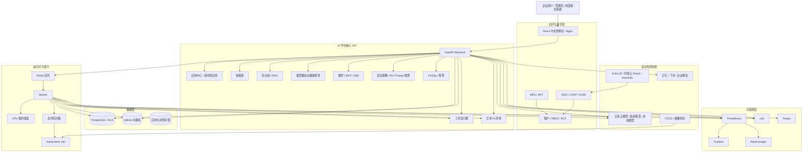
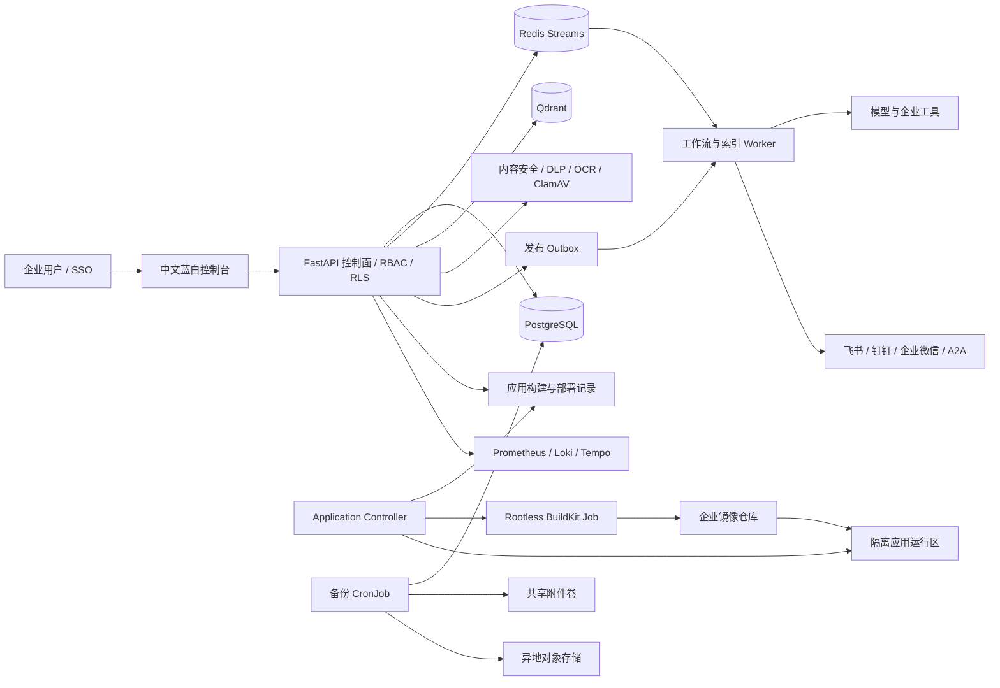

# 企业 AI 中台架构与汇报说明

## 1. 文档目的

本文档用于说明当前企业 AI 中台的技术架构、代码实现、当前完成度，以及向企业领导汇报时应关注的建设目标。

当前版本已经形成可运行的平台骨架和核心控制面，但真实模型、GPU、企业身份系统、Kubernetes 沙箱和多区域灾备仍需要接入企业实际基础设施后完成生产验收。

## 2. 当前总体架构



## 3. 当前运行拓扑

本地 Docker Compose 已运行以下服务：

| 层级 | 服务 | 作用 |
|---|---|---|
| 入口 | frontend | React 控制台和 Nginx 静态服务 |
| API | backend | FastAPI 企业 AI 中台后端 |
| 异步 | worker | 工作流、知识库、评测、沙箱任务消费者 |
| 关系数据 | postgres | 租户、用户、权限、工作流和审计数据 |
| 队列 | redis | 工作流、索引、评测和沙箱任务队列 |
| 向量数据 | qdrant | 知识库向量检索 |
| 指标 | prometheus | 指标采集 |
| 看板 | grafana | 运行指标和运维看板 |
| 日志 | loki / promtail | 容器日志集中查询 |
| 链路 | tempo | Trace 数据 |
| 告警 | alertmanager | 告警路由和通知 |

访问地址：

- 控制台：http://localhost:13000
- API 文档：http://localhost:18080/docs
- Grafana：http://localhost:13001
- Prometheus：http://localhost:19090

## 4. 代码结构说明

```text
enterprise_ai_platform/
├─ backend/
│  ├─ app/main.py                 # FastAPI 路由、鉴权和平台核心 API
│  ├─ app/models.py               # 租户、用户、工作流、GPU、沙箱、评测模型
│  ├─ app/schemas.py              # API 请求和响应结构
│  ├─ app/security.py             # JWT、密码、密钥加解密
│  ├─ app/services/workflow.py    # 工作流和 Redis Worker 执行链路
│  ├─ app/services/sandbox.py     # 受限 Kubernetes Job Manifest 生成
│  ├─ app/services/alerts.py      # 通用 Webhook、钉钉、飞书、企业微信适配
│  ├─ app/services/totp.py        # MFA/TOTP 实现
│  ├─ app/sandbox_controller.py   # Kubernetes 沙箱 Job 控制器
│  └─ migrations/versions/        # Alembic 数据库迁移
├─ frontend/src/main.jsx          # 中文企业控制台和管理页面
├─ deploy/k8s/                    # Kubernetes 部署、区域和安全清单
├─ deploy/acceptance/             # 可执行验收脚本
├─ docker-compose.yml             # 本地和单机部署
└─ docker-compose.rls.yml         # PostgreSQL RLS 运行覆盖
```

## 5. 已实现的核心能力

| 能力 | 当前实现 |
|---|---|
| 企业身份 | JWT、MFA/TOTP、OIDC、LDAP、SCIM 2.0 基础流程 |
| 组织权限 | 租户、成员、内置角色、自定义角色、权限目录、RLS |
| 模型能力 | OpenAI 兼容模型接入、聊天、Embedding、健康检查、基础路由 |
| 知识能力 | 文档切分、Embedding、Qdrant 检索、知识库绑定 |
| 智能体 | Agent 创建、模型绑定、知识库绑定、对话接口 |
| 工作流 | 节点执行、条件、循环、并行、审批、定时任务、发布版本 |
| 应用开发 | 低代码应用、公开调用接口、应用版本和运行时配置 |
| 插件治理 | Plugin、MCP、Skill、能力白名单、插件审批状态 |
| 运行时 | Redis 异步队列、GPU 租约、沙箱 Job Manifest、异步评测 |
| 安全 | PII 脱敏、Prompt 注入检查、密钥加密、密钥轮换、审计 |
| 运维 | Prometheus、Grafana、Loki、Tempo、Alertmanager |
| 成本 | Token、CPU、GPU 使用量统计和租户预算 |

## 6. 当前仍需补齐的生产闭环

这些项目不是简单页面问题，而是需要企业基础设施和安全流程共同完成：

1. 配置真实模型提供商、Embedding 模型和模型 API 密钥。
2. 接入企业 OIDC/LDAP/阿里云 IDaaS/Keycloak，并完成角色映射验收。
3. 在 Kubernetes GPU 节点上部署真实 GPU 调度，并校验租户配额和设备隔离。
4. 部署 `app.sandbox_controller`，让沙箱任务真正创建和回收 Kubernetes Job。
5. 完善预算超限后的强制阻断、账单导出和部门成本分摊。
6. 配置真实告警通道，并把运行失败、预算超限、GPU 不足接入告警规则。
7. 将 PostgreSQL、Redis、Qdrant 替换为 Operator 或云厂商高可用服务。
8. 完成跨区域复制、DNS/流量切换、备份恢复和故障演练。
9. 生产环境使用 Secret、Vault 或 KMS，替换 Compose 中的默认连接配置。
10. 对全代码运行时、插件和 MCP 进行安全扫描、网络隔离和资源压测。

## 7. 向企业领导汇报的标准口径

### 7.1 一句话说明

企业 AI 中台不是单独部署一个大模型，而是建设企业统一的 AI 基础设施：统一管理模型、算力、知识、智能体、工作流和 AI 应用，同时提供身份权限、安全审计、成本管理和生产运维能力。

### 7.2 业务价值

- 统一模型和算力，避免各部门重复采购和重复建设。
- 统一智能体和工作流开发，缩短业务 AI 应用上线时间。
- 统一知识库和权限，降低企业数据泄露风险。
- 统一评测和观测，让 AI 结果可追踪、可衡量、可改进。
- 统一成本核算，让管理层知道每个部门、应用和模型的使用成本。

### 7.3 领导最关心的验收指标

| 方向 | 建议验收指标 |
|---|---|
| 上线效率 | 新 AI 应用从需求到发布的平均周期 |
| 使用规模 | 活跃用户数、应用数、智能体调用量 |
| 质量 | 评测通过率、人工转接率、错误率 |
| 成本 | 单次调用成本、部门成本、模型成本占比 |
| 安全 | 权限违规次数、敏感数据拦截率、审计覆盖率 |
| 稳定性 | API 可用性、工作流成功率、P95 延迟 |
| 算力 | GPU 利用率、排队时间、租户配额使用率 |
| 灾备 | RTO、RPO、备份恢复成功率、故障切换时间 |

## 8. 正常企业 AI 中台必须具备的十个方面

1. 企业身份与权限：OIDC、LDAP、AD、MFA、SCIM、RBAC、ABAC、多租户和数据隔离。
2. 模型管理：公有云、私有模型、本地模型、路由、降级、健康检查、评测和密钥管理。
3. 算力管理：CPU、GPU、显存、队列、配额、优先级和成本核算。
4. 知识和数据治理：文档解析、向量化、权限过滤、版本、引用和数据生命周期。
5. 智能体平台：Agent、Prompt、工具调用、记忆、知识库绑定和评测。
6. 工作流平台：可视化编排、审批、定时任务、重试、补偿、发布和灰度。
7. 应用开发平台：低代码、全代码、SDK、API、应用市场和复用机制。
8. 插件和工具治理：Skill、Plugin、MCP、审批、版本、权限和沙箱隔离。
9. 安全与合规：PII、Prompt 注入、内容安全、审计、密钥轮换和留存策略。
10. 生产运维：CI/CD、监控、日志、Tracing、SLO、告警、备份、灾备和多区域。

## 9. 当前版本结论

当前平台已经完成软件平台骨架、核心控制面和本地可运行环境，适合进入企业试点和基础设施接入阶段；不能把当前 Compose 环境直接作为生产高可用环境。

生产上线前必须完成模型和身份接入、GPU 节点接入、沙箱控制器部署、密钥替换、预算强制策略、告警联动、数据库高可用和灾备演练。

验收命令：

```powershell
./deploy/acceptance/priority-runtime.ps1 -Password '管理员密码'
```
## 当前生产架构补充（2026-10-21）



向企业领导汇报时，可把中台归纳为六个可验收层面：统一身份与租户权限、模型与算力治理、知识/Agent/工作流开发平台、低代码和全代码应用交付、生产安全与可观测、备份容灾与持续交付。每一层都应同时说明“平台已实现什么、企业需提供什么、上线用什么指标验收”，避免只展示页面数量。
