# 企业 AI 中台架构图集

本图集依据当前项目代码、Docker Compose 拓扑、Kubernetes 清单、数据库隔离、评测流水线和沙箱控制器整理。全部图片采用统一蓝白企业风格，尺寸为 1672 × 941，可直接用于汇报、方案评审和安全评审。

> 说明：逻辑流程图描述当前软件实现；Kubernetes 生产部署图同时展示企业生产目标形态，其中高可用数据库、对象存储、镜像仓库和企业身份源需要由目标企业环境提供。

## 一、系统架构图

### 1. 逻辑分层架构

适合向管理层说明中台覆盖的能力层次，以及身份、AI 开发、治理、运行时、数据和运维之间的关系。

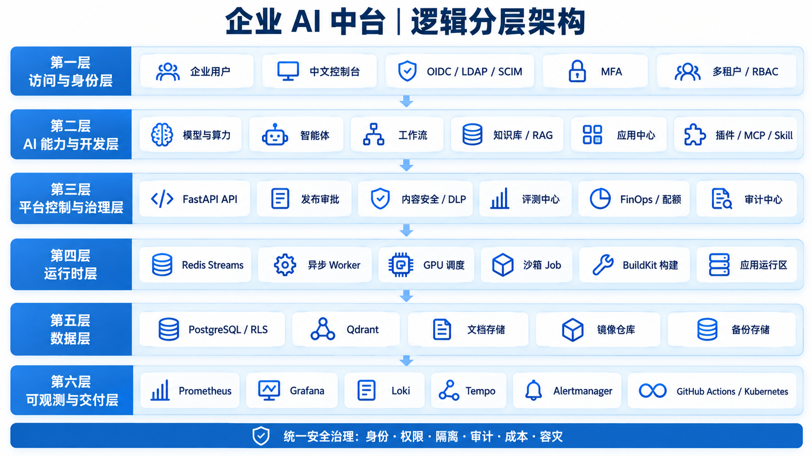

### 2. Kubernetes 生产部署架构

适合部署评审，展示入口、平台控制区、应用运行区、数据服务区、可观测区和企业外部服务。

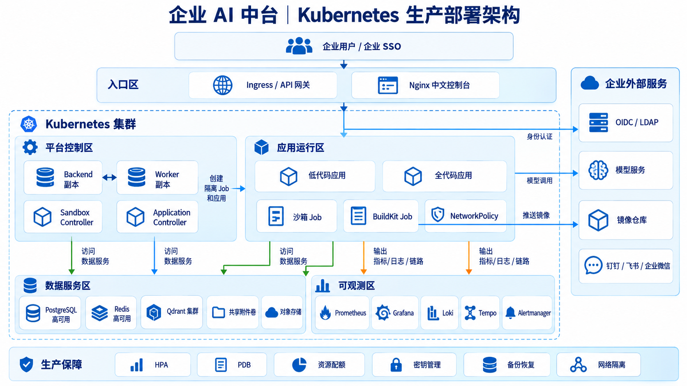

### 3. 端到端调用链路

适合研发和运维评审，展示一次请求从登录、租户上下文、知识检索、模型路由到结果安全检查的同步与异步链路。

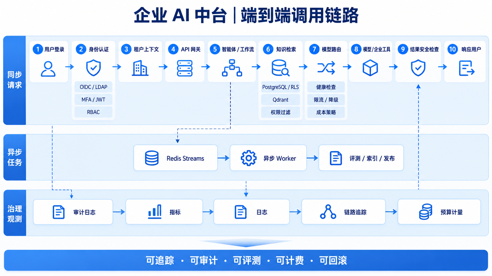

## 二、租户处理架构图

### 1. 租户生命周期

展示租户创建、身份接入、成员同步、角色分配、资源配置、开发发布、运营审计和退出流程。

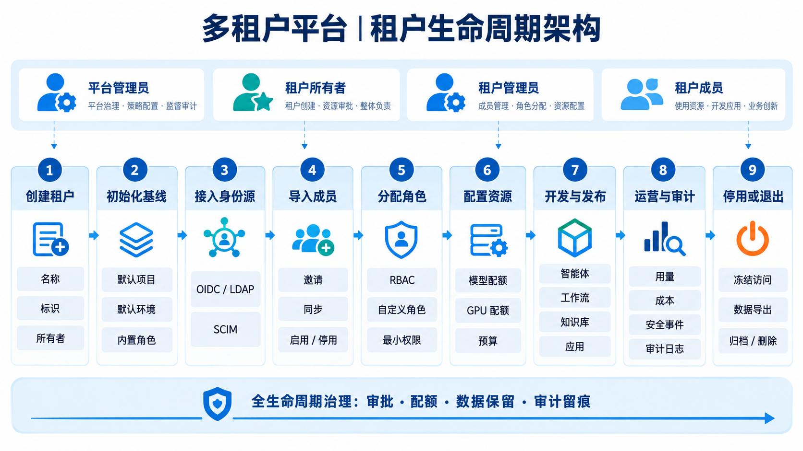

### 2. 请求隔离与权限判定

展示身份载荷、租户上下文、RBAC、自定义角色、资源归属、PostgreSQL RLS、Qdrant 过滤和全量审计。

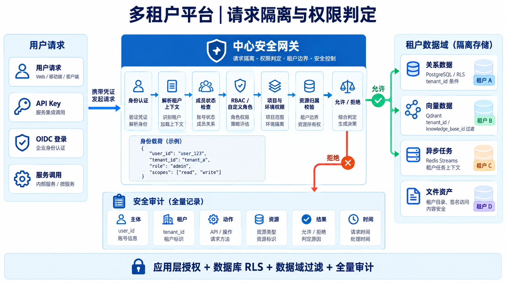

### 3. 配额、计量与成本闭环

展示模型、CPU、GPU、存储、工作流和应用调用的用量归属、成本计算、预算策略及部门分摊。

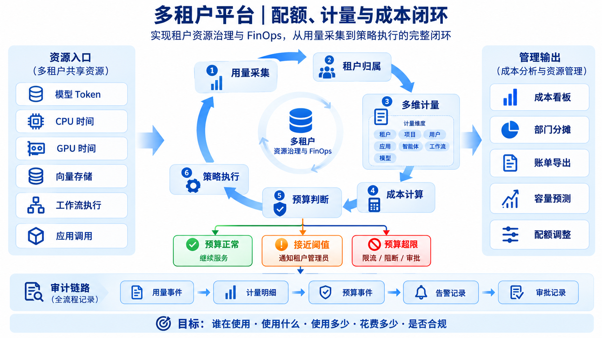

## 三、评测架构图

### 1. 离线评测流水线

展示评测集版本、异步执行、自动评分、指标聚合、质量门禁、报告和失败案例优化闭环。

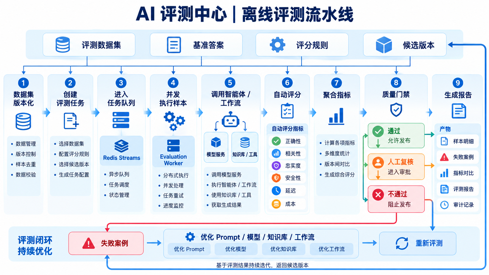

### 2. 在线灰度与自动回滚

展示稳定版本与灰度版本的流量分配、实时指标比较、逐步放量、人工审批和自动回滚。

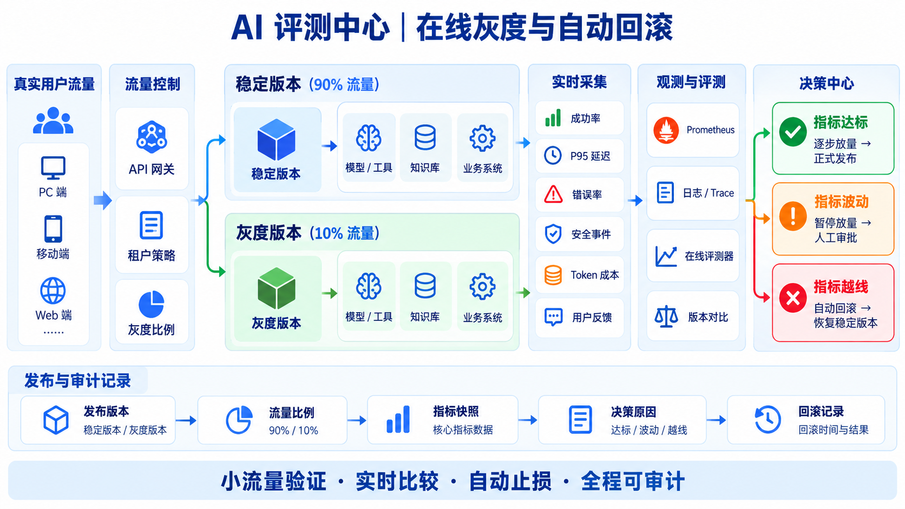

### 3. 多维质量治理

展示自动评测、性能评测、成本评测、人工评审、安全红队和持续优化之间的统一治理关系。

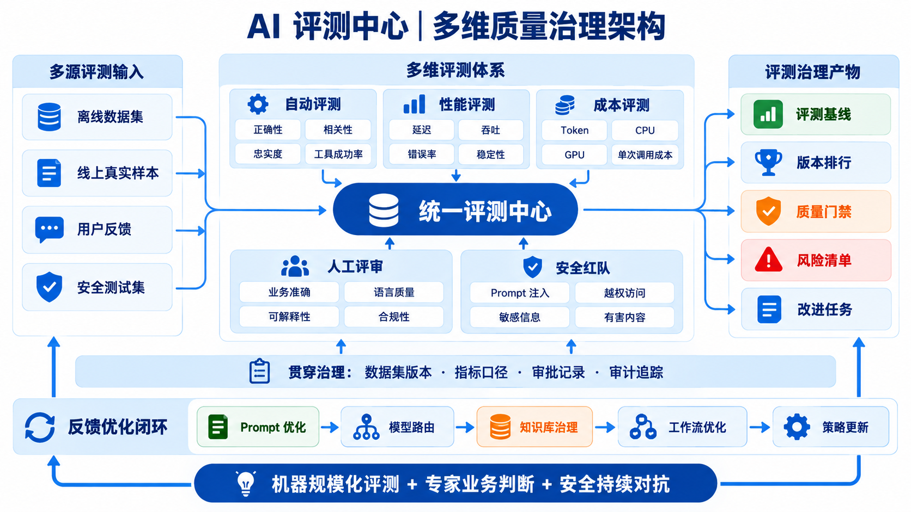

## 四、沙箱架构图

### 1. 安全执行控制链路

展示请求校验、Redis Streams、Worker、受限 Job 清单、Sandbox Controller、Kubernetes Job、日志收集和资源删除。

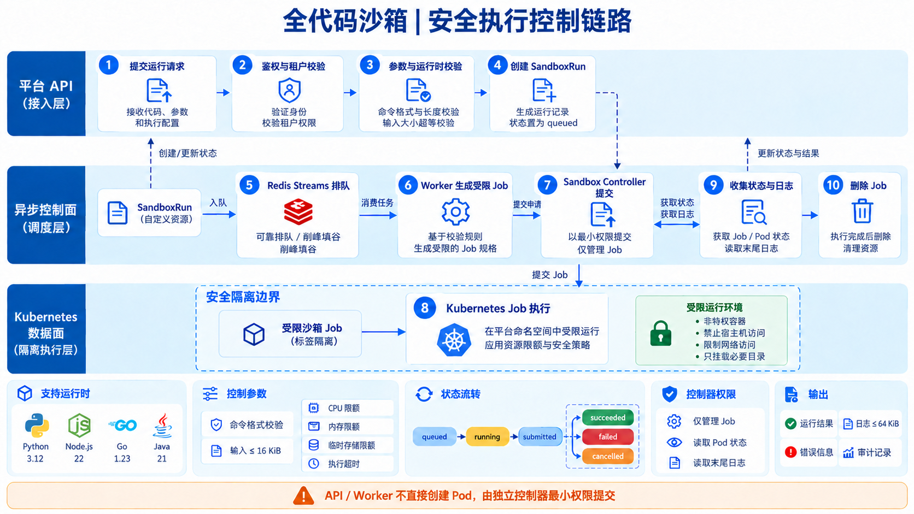

### 2. Kubernetes 纵深隔离

展示标签边界、默认禁网、最小 RBAC、非 root、Seccomp、只读根文件系统、资源限制和生命周期控制。

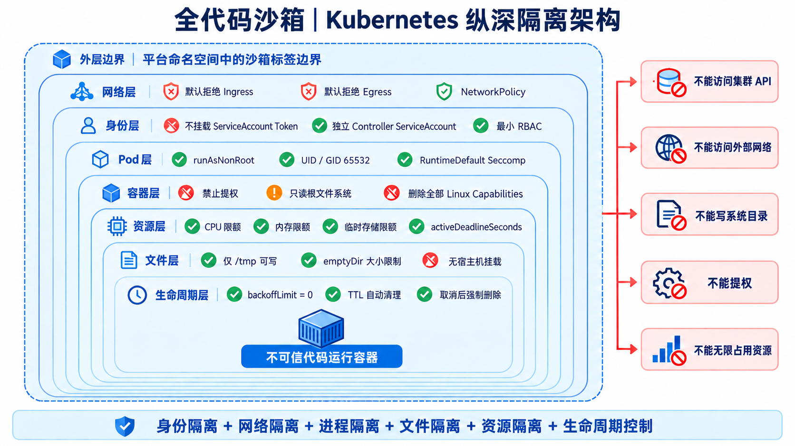

### 3. 运行状态与回收

展示沙箱任务状态机、控制器协调循环、成功/失败/取消路径、日志持久化和 Job 回收策略。

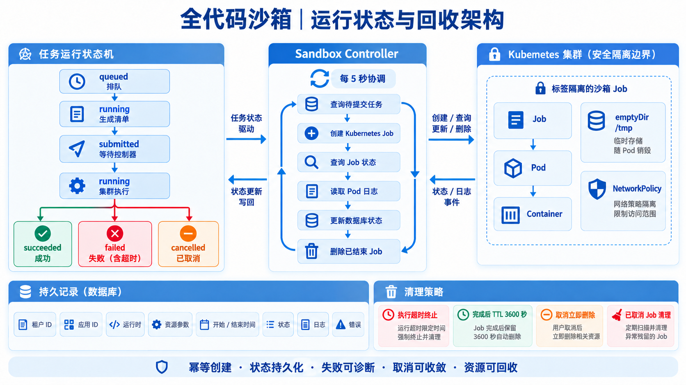

## 五、汇报使用建议

- 面向企业领导：优先使用“逻辑分层架构”“租户生命周期”“多维质量治理”。
- 面向技术委员会：优先使用“Kubernetes 生产部署”“端到端调用链路”“在线灰度与自动回滚”。
- 面向安全团队：优先使用“请求隔离与权限判定”“Kubernetes 纵深隔离”“安全执行控制链路”。
- 面向运营和财务：优先使用“配额、计量与成本闭环”。
