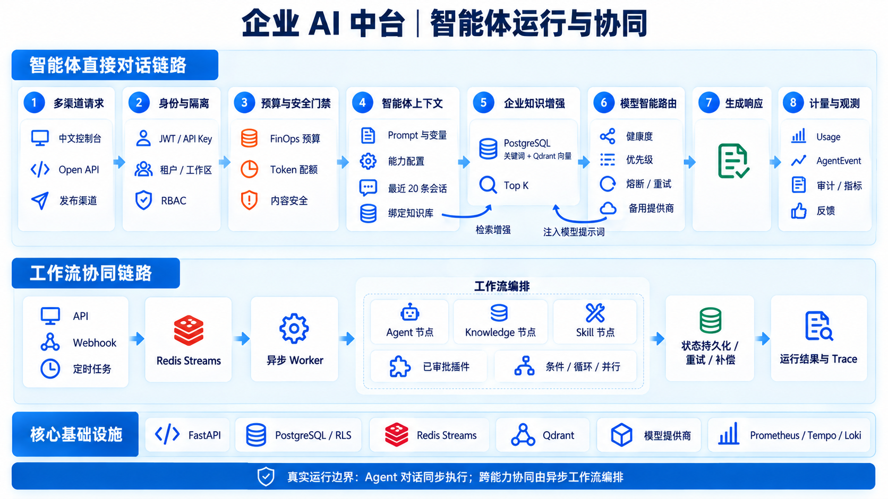
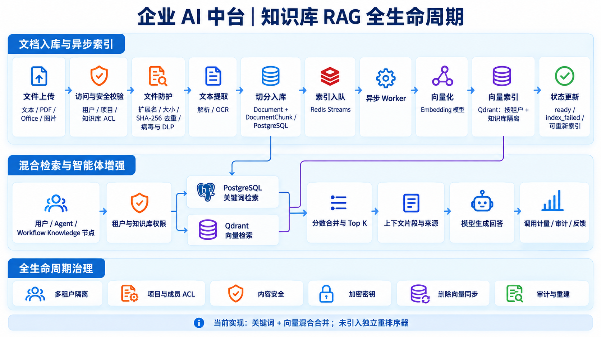
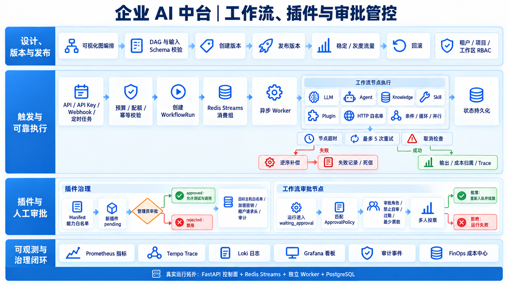

# 企业 AI 中台核心运行流程图

本图集依据 `enterprise_ai_platform` 当前代码、Docker Compose 服务和 Kubernetes 资源绘制，覆盖智能体、知识库 RAG、工作流、插件与审批管控三条核心链路。图片采用统一的中文蓝白企业风格，适合技术评审、实施方案和管理层汇报。

## 1. 智能体运行与协同

智能体直接对话由 FastAPI 同步处理，依次执行身份和租户隔离、预算与 Token 配额检查、内容安全、知识检索、模型智能路由、使用量记录和审计。跨 Agent、Knowledge、Skill 与已审批插件的协同，通过 Redis Streams 和独立 Worker 执行工作流编排。

## 2. 知识库 RAG 全生命周期

文档上传后执行类型、大小、内容指纹、病毒与 DLP 检查，完成文本解析或 OCR、切分和 PostgreSQL 落库，再通过 Redis Streams 交给 Worker 调用 Embedding 模型并写入 Qdrant。检索阶段合并 PostgreSQL 关键词结果与 Qdrant 向量结果，并将 Top K 片段提供给智能体或工作流。

## 3. 工作流、插件与审批管控

工作流支持图校验、版本发布、稳定与灰度流量、回滚、幂等运行、节点超时与重试、取消、逆序补偿和死信治理。插件创建后默认为待审批状态，只有通过管理员审批、能力白名单和目标主机白名单检查后才能测试或运行。工作流人工审批支持策略匹配、角色限制、禁止自审、过期、多人会签，以及批准后重新入队续跑。

## 图中对应的主要实现

- API 控制面：`backend/app/main.py`
- 智能体模型路由：`backend/app/services/llm.py`
- 知识检索：`backend/app/services/knowledge.py`
- 向量索引：`backend/app/services/vector.py`
- 工作流与 Worker：`backend/app/services/workflow.py`
- 运行入口：`backend/app/worker.py`
- 数据模型：`backend/app/models.py`
- 部署拓扑：`docker-compose.yml`、`deploy/k8s/`

## 当前实现边界

- 智能体直接对话是同步调用，不是 Octop 单进程运行模型。
- 异步任务统一通过 Redis Streams 消费组和独立 Worker 执行。
- RAG 当前实现关键词与向量结果合并，尚未引入独立重排序器。
- Agent 的能力清单可以配置；跨能力的实际运行协同由工作流节点完成。
- PostgreSQL、Redis、Qdrant、Prometheus、Tempo、Loki 和 Grafana 均属于当前部署拓扑。
