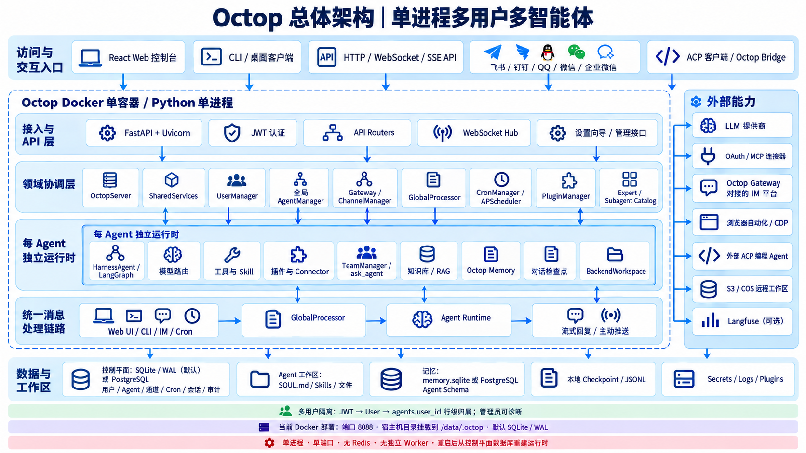
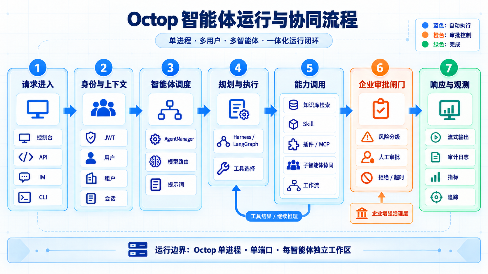
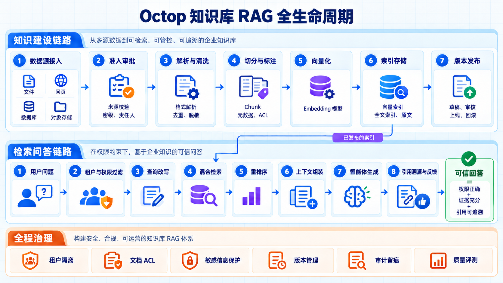
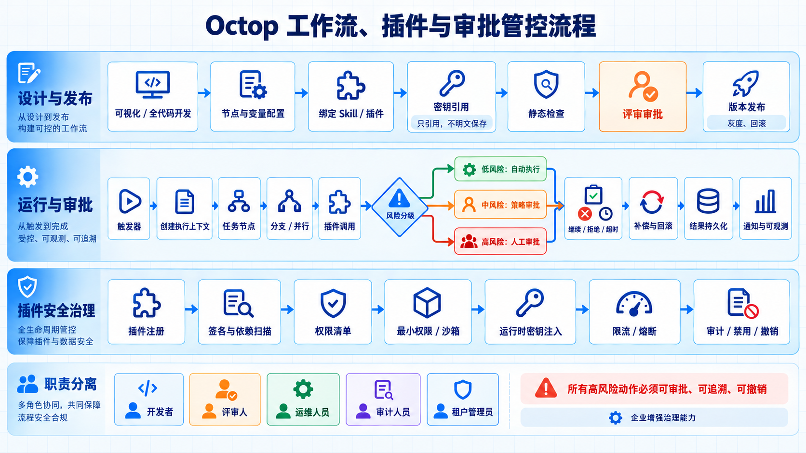

# Octop 架构与运行流程图

本图集用于说明 Octop 的总体架构，以及智能体、知识库、工作流、插件和企业审批管控的运行方式。图片采用统一的中文蓝白企业风格，适合用于技术评审、实施方案和管理层汇报。

> 说明：Octop 当前采用单进程、单端口的多用户多智能体架构。图中的人工审批、插件签名、运行沙箱和职责分离属于企业增强治理能力，需要结合企业身份、审批和安全基础设施落地。

## 1. Octop 总体架构

展示访问入口、API、领域协调、智能体运行时、数据存储、外部模型与连接器，以及 Docker 部署边界。

## 2. 智能体运行与协同流程

展示请求进入、身份与上下文解析、智能体调度、规划执行、能力调用、企业审批闸门、响应与可观测的完整闭环。

## 3. 知识库 RAG 全生命周期

展示知识建设、准入审批、解析清洗、切分与向量化、版本发布，以及带租户权限过滤的检索问答和引用溯源流程。

## 4. 工作流、插件与审批管控

展示工作流设计发布、运行时风险分级、人工审批、补偿回滚、插件权限清单、密钥注入、限流熔断和职责分离。

## 汇报使用建议

- 面向企业领导：优先展示“总体架构”和“工作流、插件与审批管控”。
- 面向研发团队：优先展示“智能体运行与协同流程”。
- 面向数据与知识运营团队：优先展示“知识库 RAG 全生命周期”。
- 面向安全与审计团队：重点说明审批闸门、租户隔离、文档 ACL、运行时密钥注入和审计留痕。
